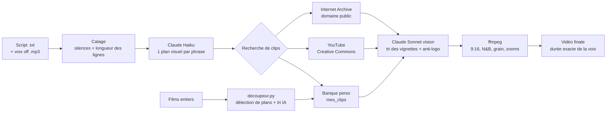

# 🖤 Studio Dark — montage vidéo automatique piloté par l'IA

> *Automated short-video editor: give it a voice-over and its script, it finds matching footage, syncs every cut to the voice and renders a vertical 9:16 video. Python · ffmpeg · Claude API (text + vision) · YouTube Data API · XTTS-v2.*

Je publie des vidéos de motivation sur TikTok (2 par jour + 1 storytelling par semaine). Chercher les images et les caler sur la voix me prenait des heures. **Studio Dark** fait ce travail tout seul : je lui donne ma voix off et mon texte, il cherche des images qui illustrent **ce qui est dit, au moment où c'est dit**, et sort une vidéo verticale prête à recevoir la musique et les sous-titres.

---

## Pour un recruteur — en 30 secondes

| | |
|---|---|
| **Problème** | Monter une vidéo de 50 s demandait 2-3 h de recherche d'images et de calage manuel. |
| **Solution** | Un pipeline Python qui combine analyse audio, deux modèles d'IA (texte + vision), trois API et ffmpeg. |
| **Résultat** | Une vidéo de 50 s calée sur la voix en ~10 min, pour quelques centimes d'API. |
| **Ce que ça montre** | Intégration d'API, traitement audio/vidéo, prompt engineering, gestion d'erreurs, tests automatisés, sécurité des clés. |

Le projet a été conçu et testé sur mes vraies vidéos, puis amélioré itération après itération à partir des défauts constatés (images hors sujet, décalage de 1 s sur la voix, plans noirs, logos…). Développé avec l'aide de Claude (IA) comme binôme de programmation.

---

## Ce que fait le projet

Trois outils qui travaillent ensemble :

| Outil | Rôle |
|---|---|
| `studio.py` | **Le monteur.** Voix off + script → vidéo 9:16 calée sur la voix. |
| `decoupeur.py` | **La banque d'images.** Découpe des films ou combats entiers en scènes de 1 à 12 s, trie et nomme chaque scène avec l'IA. |
| `voix_xtts/` | **La voix.** Clonage de voix local (modèle open source XTTS-v2) sur GPU NVIDIA. |



### Les points techniques intéressants

**1. Caler les images sur une voix « jouée ».** Ma voix off marque des pauses dramatiques *au milieu* des phrases, donc couper à chaque silence ne marche pas. Le studio combine deux indices : les silences détectés par ffmpeg, et la position attendue de chaque ligne d'après son nombre de mots. Un **algorithme de programmation dynamique** choisit, parmi tous les silences, celui qui correspond le mieux à chaque changement de ligne. Résultat testé : le bon silence est trouvé à chaque ligne, même avec des pauses en plein milieu de phrase.

**2. Deux modèles d'IA selon la tâche.** Haiku (rapide, peu cher) écrit la liste des plans et les requêtes de recherche. Sonnet (vision) regarde des **planches de vignettes** recadrées en vertical, comme dans la vidéo finale, choisit le meilleur clip et le meilleur moment, et rejette ceux avec logo, watermark ou texte incrusté. Coût d'une vidéo de 50 s : quelques centimes.

**3. Ne jamais se décaler de la voix.** Bug trouvé en production : quand un clip source était plus court que prévu, chaque plan suivant arrivait un peu trop tôt (1,2 s d'avance à la fin). Correction : la dernière image est figée (`tpad`) pour que chaque plan garde sa durée exacte. Un test automatique vérifie ce cas.

**4. Robustesse.** Si aucun clip ne convient, Claude propose de nouvelles pistes de recherche (jusqu'à 4 tentatives) au lieu de laisser un trou. Des filtres automatiques (luminosité, netteté, contraste) rejettent les images noires ou floues avant de payer un appel d'IA. Les réponses coupées de l'API sont détectées et redemandées.

**5. Le découpeur de films.** Un seul passage ffmpeg détecte les changements de plan **et** extrait une vignette par seconde. Claude trie les scènes par planches de 20 (≈ quelques centimes par film de 2 h) et nomme les bonnes en anglais (`roman_legion_marching.mp4`, `boxer_knockout_punch.mp4`). Ces noms servent ensuite de mots-clés au studio. Test réel : 232 min de combats découpées en plus de 1 200 scènes correctement nommées.

**6. Clonage de voix local.** Installation de XTTS-v2 sur GPU (RTX 2000 Ada) dans un environnement Python séparé : le modèle n'existe pas pour la version de Python du PC. Contournement d'un bug de chargement audio sous Windows (torchcodec/FFmpeg) en remplaçant la fonction de lecture par `soundfile`.

---

## Installation (Windows)

1. Installer **Python** (python.org, cocher « Add Python to PATH ») et **ffmpeg** (`winget install Gyan.FFmpeg`).
2. Double-cliquer sur **`INSTALLER.bat`** : il vérifie Python et ffmpeg, installe les modules et crée le fichier `.env`.
3. Coller les clés dans `.env` :
   - `ANTHROPIC_API_KEY` : console.anthropic.com (payant à l'usage, quelques centimes par vidéo) ;
   - `YOUTUBE_API_KEY` : Google Cloud, YouTube Data API v3 (gratuit).

## Utilisation

```
scripts/
  caesar.txt   ← une phrase par ligne, à chaque pause de la voix
  caesar.mp3   ← la voix off, même nom
```

Double-clic sur **`LANCER_STUDIO.bat`** → format (long 50-70 s / court 6-8 s) → script → mots-clés éventuels. Le studio affiche chaque plan avec la phrase dite (et sa traduction si le script est en anglais), puis génère la vidéo dans `sorties/`, avec un fichier de crédits et le calage « moment → phrase ».

- **Banque de scènes :** déposer des vidéos entières dans `a_decouper/` puis lancer `DECOUPER_FILMS.bat`.
- **Place disque :** `LIBERER_ESPACE.bat` déplace les gros dossiers vers un autre disque (`DOSSIER_DONNEES` dans `.env`).
- **Voix clonée :** `voix_xtts/INSTALLER_XTTS.bat`, puis `GENERER_VOIX.bat` (texte dans `texte.txt`, voix de référence `reference.wav`).

## Tests

```
pip install pytest numpy
pytest -q
```
Les tests tournent **sans clé API ni réseau** : calage sur une voix synthétique avec pauses au milieu des phrases, absence de dérive de durée, plan prolongé quand le clip est trop court, format vertical. La CI GitHub lance les tests et un **scan anti-fuite de clés** (gitleaks) à chaque push.

## Sécurité, droits et limites

- **Aucune clé n'est dans le dépôt** : elles vivent dans `.env`, exclu par `.gitignore` et vérifié par la CI.
- **Aucune vidéo n'est incluse.** Les clips YouTube sont filtrés sur la licence Creative Commons (vérifiée vidéo par vidéo), et le crédit des auteurs est généré automatiquement. Ce que l'utilisateur met dans sa banque personnelle relève de sa responsabilité.
- **XTTS-v2** est sous licence Coqui Public Model License : usage **non commercial** uniquement.
- **Limites connues :** les banques libres manquent d'images historiques (Rome antique…), d'où la banque personnelle. Une histoire avec le même personnage du début à la fin reste difficile avec des images issues de sources différentes.

## Ce que j'ai appris

- Faire dialoguer plusieurs API et deux modèles d'IA dans un même pipeline, et choisir le bon modèle selon le coût et la tâche.
- Traiter de l'audio et de la vidéo avec ffmpeg : détection de silences et de plans, filtres, encodage.
- Écrire des prompts précis et des garde-fous pour des réponses d'IA imparfaites (JSON invalide, réponses coupées, mauvais choix).
- Déboguer à partir de vrais résultats : mesurer (durées, luminosité, timings) plutôt que deviner.
- Protéger des secrets et automatiser les vérifications (tests + CI).

---
*Projet personnel — David, 2026.*
